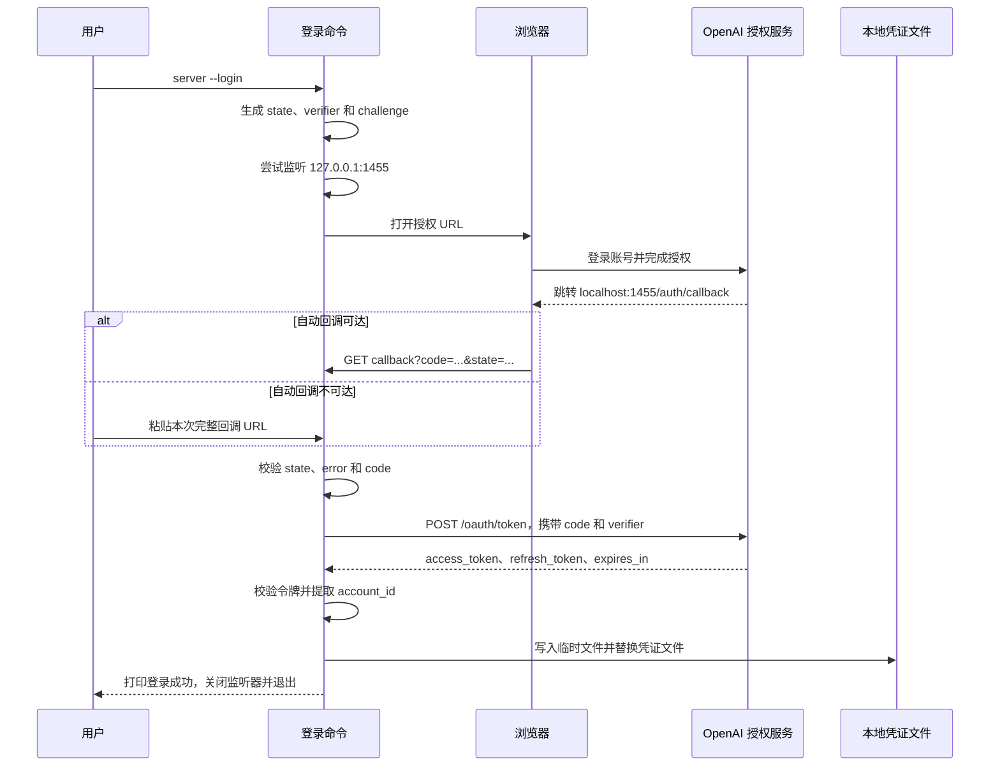
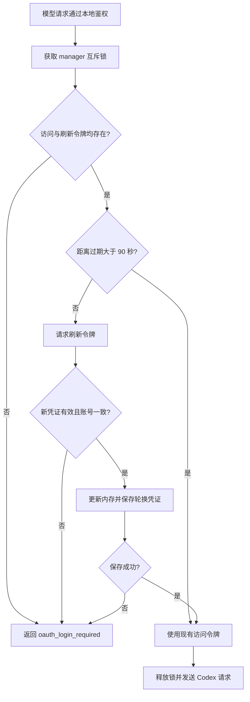

# OpenAI Codex 鉴权完整流程

本文描述 hao-agent-harness 当前实现的 OpenAI Codex 登录、凭证管理和模型调用流程。对应配置为 `auth_type: openai_codex`，入口为 `go run ./cmd/server --login`。内容按 2026-10-10 的项目代码核对。

## 1. 两层鉴权与三个端口

调用链中存在两层独立的鉴权：

```text
浏览器 / API 客户端
  ── Authorization: Bearer <CLIENT_API_KEYS 中的令牌> ──► 本服务
本服务
  ── Authorization: Bearer <OpenAI access_token> ──► Codex 模型接口
```

| 对象 | 用途 | 存储及使用方式 |
| --- | --- | --- |
| `CLIENT_API_KEYS` | 控制谁能访问本服务 | 从启动进程的环境变量读取；当前目录 `.env` 补充未设置的变量；支持逗号分隔的多个令牌 |
| OAuth `access_token` | 代表已登录账号调用 Codex | 从凭证文件读取，由服务端放入上游认证头 |
| OAuth `refresh_token` | 换取新的访问令牌 | 只用于服务端的刷新请求，不发给工作台 |
| `account_id` | 指定对应的 ChatGPT 账号 | 提取自访问令牌，发送为 `ChatGPT-Account-Id` |
| `client_id` | 标识 OAuth 公共客户端 | 固定协议参数，不是本服务访问令牌，也不是 client secret |

`--login` 成功不会设置 `CLIENT_API_KEYS`，也不会自动启动服务。服务启动成功、健康检查成功、OAuth 文件存在，也都不等于一次模型调用一定成功。

| 端口 | 默认用途 | 生命周期 |
| --- | --- | --- |
| `1455` | 接收浏览器 OAuth 回调 | 仅登录期间临时监听 `127.0.0.1` |
| `8080` | 工作台与聊天 API | 服务运行期间；由 `HTTP_ADDR` 指定 |
| `9090` | Prometheus 指标 `/metrics` | 服务运行期间；`METRICS_ADDR=''` 可关闭 |

工作台只在页面初始化时请求一次 `/healthz`。该请求不验证 OpenAI 账号，也不触发访问令牌刷新。

## 2. 从登录到启动的操作步骤

在项目根目录打开 PowerShell：

```powershell
Set-Location C:\Users\16255\code\hao-agent-harness

# 首次登录。已登录时通常无需重复执行。
go run ./cmd/server --login

# 这是本服务的访问令牌，由你设置。
$env:CLIENT_API_KEYS = 'replace-with-your-local-service-token'

# 可选：关闭指标端口。
$env:METRICS_ADDR = ''

# 默认读取 configs/models.json。
go run ./cmd/server
```

`configs` 中只保留一个模型配置文件：

```json
{
  "providers": {
    "openai": {
      "auth_type": "openai_codex"
    }
  },
  "models": {
    "default": {
      "provider": "openai",
      "upstream_model": "gpt-6-luna"
    }
  }
}
```

`default` 是客户端使用的模型别名，`upstream_model` 是发给上游的模型 ID。请使用账号可调用的真实 ID，不要填写界面展示名称。Codex 配置默认开启流式能力，关闭 temperature 和 max_tokens，因此无需填写 `max_output_tokens`。

启动后打开 `http://127.0.0.1:8080/`，在连接设置中填写与启动时 `CLIENT_API_KEYS` 相同的值，再加载模型和发送消息。服务和 `--login` 都自动加载当前工作目录的 `.env`，已有环境变量优先（包括显式空值）。因此也可把 `CLIENT_API_KEYS` 和可选的 `OPENAI_CODEX_TOKEN_FILE` 写入 `.env`，无需逐次在终端设置。登录与启动应使用同一工作目录或显式设置同一凭证路径。变更环境变量、`.env` 或模型配置后需要重启。文件不存在时允许继续，读取或格式错误时退出；格式、大小限制及排错见 [README](../README.md#本地运行) 和 [.env 加载设计](dotenv-loading-design.md)。

## 3. 登录入口与参数

以下三个命令等价，均登录 OpenAI Codex：

```powershell
go run ./cmd/server --login
go run ./cmd/server --login openai
go run ./cmd/server --login=openai-codex
```

| 参数 | 默认值 | 行为 |
| --- | --- | --- |
| `--login` | OpenAI Codex | 独立登录，保存凭证后退出，不启动 API 和指标服务 |
| `--no-browser` | `false` | 不自动打开浏览器，仍打印登录 URL、尝试启动本机回调监听器 |
| `--login-timeout` | `10m` | 限制整个登录过程，必须为正的 Go duration |

`--no-browser` 和 `--login-timeout` 仅可与 `--login` 一起使用。其他登录提供商会被拒绝。参数解析错误返回退出码 2，登录失败返回 1，成功返回 0。

入口先解析参数，再判断是否进入登录分支。因此登录不需要 `MODEL_CONFIG_PATH`、`CLIENT_API_KEYS` 或上游 API Key。登录成功后才需要按第 2 节启动服务。

自动打开浏览器使用 Windows 的 `rundll32 url.dll,FileProtocolHandler`、macOS 的 `open` 或 Linux 的 `xdg-open`。打开失败时打印提示，仍可手动复制登录 URL。

## 4. 协议参数与 PKCE

当前协议参数参考 [pi 的 OpenAI Codex OAuth 实现](https://github.com/earendil-works/pi/blob/main/packages/ai/src/auth/oauth/openai-codex.ts)，具体行为以本仓库代码为准。

| 参数 | 当前值 |
| --- | --- |
| 授权端点 | `https://auth.openai.com/oauth/authorize` |
| 令牌端点 | `https://auth.openai.com/oauth/token` |
| OAuth client ID | `app_EMoamEEZ73f0CkXaXp7hrann` |
| 注册回调 URI | `http://localhost:1455/auth/callback` |
| 实际监听地址 | `127.0.0.1:1455` |
| scope | `openid profile email offline_access` |
| originator | `hao-agent-harness` |

每次登录生成两个独立的密码学随机值：`state` 和 `code_verifier`。二者都来自 32 个随机字节，采用无填充的 Base64URL 编码。PKCE challenge 的计算为：

```text
code_challenge = Base64URLWithoutPadding(SHA256(code_verifier))
```

浏览器授权请求包含以下查询参数：

```text
response_type=code
client_id=app_EMoamEEZ73f0CkXaXp7hrann
redirect_uri=http://localhost:1455/auth/callback
scope=openid profile email offline_access
state=<本次登录随机值>
code_challenge=<verifier 的 SHA-256 编码>
code_challenge_method=S256
id_token_add_organizations=true
codex_cli_simplified_flow=true
originator=hao-agent-harness
```

真实 URL 会正确编码空格和特殊字符。`state` 用于确认回调属于本次登录；`verifier` 留在登录进程内存中，只有交换授权码时才发送给令牌端点。此流程没有 client secret。

## 5. 浏览器授权与回调



临时 HTTP 服务只接受 `GET /auth/callback`。其他路径返回 404，其他方法返回 405。回调响应设置 `Cache-Control: no-store`。回调必须满足：

1. 查询参数 `state` 与当前内存中的值完全一致。
2. 不包含 OAuth `error`。
3. `code` 非空。

不匹配的 state 返回 400，但不会取消正在等待的登录，以免无关浏览器标签页中断当前流程。state 匹配而授权失败的回调会结束登录。

浏览器显示“Authorization received”仅表示已收到授权码。最终成功以终端中的“登录成功，凭证已保存”为准，因为之后还需要交换令牌并写入文件。

## 6. 手动回调、远程环境与取消

```powershell
go run ./cmd/server --login openai --no-browser --login-timeout 5m
```

当端口 1455 被占用，或浏览器与登录命令位于不同机器时，可以手动完成：

1. 保持登录命令运行，在能访问 OpenAI 的浏览器中打开终端打印的授权 URL。
2. 完成账号登录和授权。
3. 若跳转后的 localhost 页面无法打开，复制地址栏中的完整 URL。
4. 粘贴到运行登录命令的终端并按 Enter。

回调 URL 的形式为：

```text
http://localhost:1455/auth/callback?code=<一次性授权码>&state=<本次state>
```

本项目读取 URL 查询参数中的 `code` 和 `state`。不支持仅粘贴裸授权码，也不会因为输入来自其他登录尝试就忽略 state 校验。输入解析错误或 state 错误时提示重试；state 匹配且携带授权错误时结束登录。

`--no-browser` 只是禁止自动打开浏览器，不是设备码登录。当前项目未实现 pi 的设备码登录模式。浏览器无法访问 OpenAI 时，手动粘贴也不能完成授权。

默认等待最多 10 分钟；Ctrl+C、终止信号或超时都会取消登录。登录分支的 HTTP 客户端另有每次请求 30 秒超时。退出前关闭临时监听器。标准输入结束后，若回调监听仍可用，会继续等待浏览器；若监听不可用，则返回输入已关闭错误。

## 7. 授权码交换与令牌校验

登录命令发送表单编码的 POST：

```http
POST /oauth/token HTTP/1.1
Host: auth.openai.com
Content-Type: application/x-www-form-urlencoded
Accept: application/json
```

表单字段为：

| 字段 | 内容 |
| --- | --- |
| `grant_type` | `authorization_code` |
| `client_id` | 固定 Codex client ID |
| `code` | 回调中收到的一次性授权码 |
| `code_verifier` | 本次登录保留的 verifier |
| `redirect_uri` | `http://localhost:1455/auth/callback` |

令牌请求禁止自动跟随重定向，成功响应必须为 HTTP 200，并能在 64 KiB 读取上限内解码为 JSON。非 200 时返回状态摘要，不把上游正文输出为错误信息。

`codexCredentials` 验证：

- `access_token` 和 `refresh_token` 均非空。
- `expires_in` 大于 0 且不超过 365 天。
- `token_type` 可省略；存在时必须为 Bearer，大小写不敏感。
- 访问令牌必须有三个点分段，第二段能按 Base64URL 解码为 JSON。
- `https://api.openai.com/auth.chatgpt_account_id` 对应的嵌套账号字段非空且不包含换行。

准确的账号字段结构是：

```json
{
  "https://api.openai.com/auth": {
    "chatgpt_account_id": "<account-id>"
  }
}
```

这里的解码用于读取 HTTPS 令牌端点返回的账号元数据，**没有进行 JWT 签名、issuer、audience 或 nonce 验证**。本模式也不要求 token response 返回特定 scope 或 ID Token。这些行为与项目另一条网页 `openai_oauth` 流程不同。解码后的 JWT 不用于验证本服务的客户端身份。

有效期使用本机当前时间加 `expires_in` 计算，访问令牌内的 `exp` 不参与当前刷新判断。

## 8. 凭证存储与重新登录

文件路径按以下优先级确定：

1. 非空的 `OPENAI_CODEX_TOKEN_FILE` 环境变量。
2. `os.UserConfigDir()/hao-agent-harness/openai-codex.json`。

本机 Windows 的默认位置为：

```text
C:\Users\16255\AppData\Roaming\hao-agent-harness\openai-codex.json
```

使用自定义路径时，登录和启动服务必须采用同一个值：

```powershell
$env:OPENAI_CODEX_TOKEN_FILE = 'C:\Users\16255\private\openai-codex.json'
go run ./cmd/server --login
$env:CLIENT_API_KEYS = 'replace-with-your-local-service-token'
go run ./cmd/server
```

以下仅展示凭证的关键字段，全部使用占位内容：

```json
{
  "client_id": "app_EMoamEEZ73f0CkXaXp7hrann",
  "account_id": "<account-id>",
  "access_token": "<access-token>",
  "refresh_token": "<refresh-token>",
  "expires_at": "2026-10-10T23:00:00+08:00"
}
```

共享凭证结构还包含 `id_token`、`ext_agent_host_id`、`subject`、`scope` 等字段；它们可能为空，Codex 不依赖这些字段完成推理。账号邮箱不是当前 Codex 登录的提取字段，因此状态接口通常不展示邮箱。

保存时创建父目录，目标权限为 `0700`；在同目录创建独立临时文件、写入 JSON、关闭文件、设置 `0600`，然后通过 `os.Rename` 替换目标。加载已有文件时也尝试设置 `0600`。这属于本地明文凭证存储，不包含加密或 Windows 凭证管理器集成；Windows 上 `os.Chmod` 不等同于设置仅当前用户可访问的完整 NTFS ACL。

文件不存在时允许初始化未登录的 manager；文件 JSON 无效、client ID 不匹配或无法读取时返回错误，不会静默覆盖。需要修复损坏文件时，先停止服务，将其移到仅自己可访问的位置，再重新登录。

当前每个凭证文件保存一个活动账号。同一服务进程内多个 Codex provider 共用一个 manager。服务在启动时读取文件，不自动重载外部修改；切换账号应先停止服务、重新登录，再启动。

## 9. 每次模型请求与自动刷新

业务请求通过本地 Bearer 鉴权和模型能力校验后，provider 在发送上游请求之前调用 `AccessToken(ctx)`。



刷新使用同一个令牌端点，表单字段为：

```text
grant_type=refresh_token
client_id=app_EMoamEEZ73f0CkXaXp7hrann
refresh_token=<当前刷新令牌>
```

新凭证经过与首次登录相同的字段校验，并要求新 `account_id` 等于原账号 ID。成功后更新访问令牌、轮换刷新令牌和有效期，再保存文件。互斥锁覆盖整个刷新过程，防止同一 manager 的并发请求重复使用旧刷新令牌。

刷新按请求触发，没有后台刷新定时器。没有自动重试，也没有收到上游 401 后强制刷新并重发的逻辑。获取令牌失败统一映射为本服务 HTTP 503、`oauth_login_required`；远端失败、凭证不完整和保存失败均可能进入此分支。

并发保护仅在当前进程内生效，没有跨进程文件锁。不要让多个服务实例同时刷新同一文件。刷新后的保存失败会返回错误，但新凭证已更新到内存；重启后仍可能读到磁盘上的旧令牌，需要排查目录写权限并重新登录。

## 10. 携带凭证调用 Codex

上游目标地址固定为：

```text
https://chatgpt.com/backend-api/codex/responses
```

`openai_codex` 不接受配置自定义 `chat_url` 或 `api_key_env`。实际发送的关键请求头为：

```http
Authorization: Bearer <OpenAI-access-token>
ChatGPT-Account-Id: <account-id>
OpenAI-Beta: responses=experimental
Originator: hao-agent-harness
Content-Type: application/json
Accept: text/event-stream
```

本服务的 `CLIENT_API_KEYS` 不会转发给 OpenAI。请求中的 system 消息合并为 `instructions`，其他文本消息放入 `input`；没有 system 内容时使用默认助手指令。所有上游请求设置 `stream:true` 和 `store:false`。客户端请求普通 JSON 时，由本服务读取并聚合 SSE。

当前 Codex 实际响应可能缺少 `Content-Type`，适配器允许 Codex 模式下缺失该头，但仍逐条验证 SSE，并要求 `response.completed`、`response.done` 或 `response.incomplete` 完成事件。显式返回不支持的内容类型、无效 JSON 或异常断流仍报协议错误。普通 `openai_oauth` 模式保留响应类型检查。

登录成功只证明完成了凭证交换和保存；账号是否有某模型的权限，需要通过真实模型请求确认。[OpenAI Docs 的认证说明](https://learn.chatgpt.com/docs/auth)介绍了账号登录和 API Key 两种认证方式；本文的具体字段、默认值和限制来自本项目实现。

## 11. 状态、退出与两种 OAuth 模式的区别

Codex 是唯一配置的 OAuth 模式时，工作台控制接口如下：

| 接口 | 方法 | 当前行为 |
| --- | --- | --- |
| `/auth/openai/status` | GET | 返回 `connected`、`email`、`cli_login:true`，不返回令牌 |
| `/auth/openai/start` | POST | 返回 400，提示使用 `server --login openai` |
| `/auth/openai/logout` | POST | 清除本地令牌和账号 ID，保存文件；成功返回 204 |

控制接口限制回环访问，并要求本服务的 Bearer 令牌；start 和 logout 还要求 HTTP `Origin` 与请求 Host 同源。Codex 的 logout **不会调用远端撤销端点**，因此本地退出不能视为所有已发出令牌都已远端失效。状态接口的 `connected` 仅表示内存中同时存在访问令牌与刷新令牌，不会刷新或实时验证有效性。

例如，在持有相同本地访问令牌的 PowerShell 中查询状态：

```powershell
$headers = @{ Authorization = "Bearer $env:CLIENT_API_KEYS" }
Invoke-RestMethod 'http://127.0.0.1:8080/auth/openai/status' -Headers $headers

# 本地退出需要同源 Origin。
$headers.Origin = 'http://127.0.0.1:8080'
Invoke-WebRequest 'http://127.0.0.1:8080/auth/openai/logout' -Method Post -Headers $headers
```

若 `CLIENT_API_KEYS` 设置了多个逗号分隔的值，上述客户端示例应选取其中一个完整令牌，而不是把整个列表作为 Bearer 发送。

| 项目 | `openai_codex` | `openai_oauth` |
| --- | --- | --- |
| 登录入口 | 命令行 `--login` | 工作台 Continue with ChatGPT |
| 客户端标识 | 固定 Codex client ID | 动态客户端注册与保存的 client ID |
| 回调 | 独立的 localhost:1455/auth/callback | API 端口的 /auth/openai/callback |
| 推理 | ChatGPT backend-api/codex/responses | api.openai.com/v1/responses |
| 凭证文件 | openai-codex.json | openai-oauth.json |
| JWT 处理 | 解码访问令牌以读取账号 ID | 校验 ID Token 签名及身份声明 |
| 退出 | 仅清除本地凭证 | 清除本地凭证并尝试远端撤销 |

两种模式的凭证不可互换。若一个配置同时包含两种模式，聊天 provider 各自独立，但公共 `/auth/openai/*` 控制接口优先绑定网页 `openai_oauth` manager，因此不会同时展示两类账号状态。

## 12. 常见故障与验证

| 现象 | 含义与处理 |
| --- | --- |
| 本地 `/v1/models` 或聊天返回 401 | 本服务的访问令牌缺失或不匹配；核对工作台与启动环境中的 CLIENT_API_KEYS |
| `/healthz` 返回 200 | 仅证明服务存活，不证明 OAuth 或模型权限有效 |
| 提示端口 1455 不可用 | 复制本次完整回调 URL 到终端；不会改用随机回调端口 |
| `OAuth state mismatch` | URL 属于其他登录尝试或不完整；使用当前命令生成的登录 URL |
| 登录超时或取消 | 重新运行 --login；旧回调不能恢复已结束的登录进程 |
| `OpenAI Codex credential file is invalid` | 文件无法解码或 client ID 不匹配；停止服务后保留文件备份并重新登录 |
| `oauth_login_required` / HTTP 503 | 凭证缺失，或刷新、校验、保存失败；检查路径、写权限并重新登录 |
| `upstream_rate_limited` / HTTP 429 | 上游返回 429；登录成功不会绕过账号额度限制 |
| `upstream_error` / HTTP 502 | 上游非成功状态、连接失败或流内失败；当前错误正文经过净化 |
| `upstream_protocol_error` / HTTP 502 | 返回内容类型或 SSE 格式无效、缺少必需字段或完成标记；不是本地 Bearer 鉴权失败 |
| `MODEL_CONFIG_PATH is required` | 显式把 MODEL_CONFIG_PATH 设为空；取消该覆盖以使用 configs/models.json |
| `cannot open model configuration` | 默认或指定路径不存在；从项目根目录启动并检查唯一配置文件 |

业务请求日志仅记录请求 ID、路由、模型别名、provider、状态、错误类别和耗时，不记录令牌、提示词或生成内容。排查时提供这些元数据即可，避免上传实际凭证文件或授权回调 URL。

本地自动化验证不需要真实账号：

```powershell
go test -timeout 60s ./tests/cmd/server ./tests/config ./tests/openaioauth ./tests/provider ./tests/server
go vet ./...
```

测试覆盖命令行参数、PKCE、state 校验、手动回调与固定端口占用、取消、凭证保存和重新加载、并发令牌刷新、Codex 请求头、无 Content-Type 的 SSE，以及服务使用已保存凭证调用假上游。真实账号的授权、额度和模型可用性需要另行实测。

## 13. 代码索引与实现边界

| 文件 | 职责 |
| --- | --- |
| [cmd/server/main.go](../cmd/server/main.go) | 区分独立登录与服务启动，处理退出信号 |
| [cmd/server/login.go](../cmd/server/login.go) | 参数、浏览器打开、标准输入、登录超时 |
| [internal/openaioauth/codex.go](../internal/openaioauth/codex.go) | PKCE、回调、交换、账号元数据和刷新 |
| [internal/openaioauth/oauth.go](../internal/openaioauth/oauth.go) | 共享凭证结构、令牌请求、文件保存、控制接口 |
| [internal/config/config.go](../internal/config/config.go) | 默认配置路径、能力默认值与校验 |
| [internal/server/server.go](../internal/server/server.go) | 创建 manager 并注入 Codex provider |
| [internal/provider/openai_responses.go](../internal/provider/openai_responses.go) | 获取凭证、请求头与 Responses SSE 转换 |
| [internal/httpapi/handler.go](../internal/httpapi/handler.go) | 本地 Bearer 鉴权与净化后的业务日志 |
| [configs/models.json](../configs/models.json) | 唯一模型配置 |

本文记录已实现的浏览器 PKCE 流程。当前没有设备码登录、跨进程令牌刷新锁、系统钥匙串存储、Codex 远端撤销、JWT 签名校验或账号文件热重载。固定 client ID 和上游端点来自参考实现，不代表本项目拥有独立注册的 OAuth 客户端；服务端协议变化需要重新核对。端点常量应连同 [pi 的 OAuth 源码](https://github.com/earendil-works/pi/blob/main/packages/ai/src/auth/oauth/openai-codex.ts)与 [Codex 请求适配源码](https://github.com/earendil-works/pi/blob/main/packages/ai/src/api/openai-codex-responses.ts)一起审阅。
