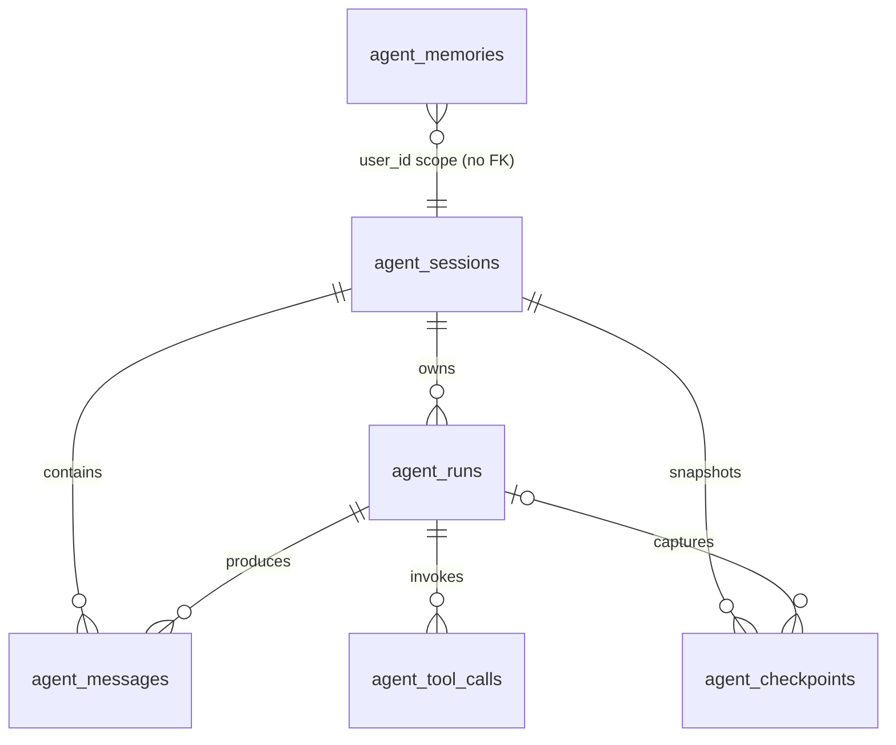

# PostgreSQL 表结构落地方案（待评审）

## 目标与现状

根据用户提供的 `Session + Message + Run + Tool Call + Checkpoint` 设计，为后续 Agent Harness 运行数据建立 PostgreSQL 表结构。当前仓库是 Go 聊天代理：请求经 HTTP handler、Service 和 Provider 转发给模型；还没有数据库客户端、Agent Run 生命周期或工具执行接口。网页会话保存在浏览器，服务端聊天日志写在文件中。

因此本次范围先限定为**版本化 SQL schema 与操作文档**。不添加 PostgreSQL Go 驱动、不改启动配置、不将聊天请求切换到数据库，也不迁移已有浏览器会话或文件日志。只有数据库结构和生命周期配套后续实现，才应宣称 Agent 会话已由 PostgreSQL 持久化。

## 建议的迁移文件

- `migrations/000001_agent_core.up.sql`：建立四张核心表和索引。
- `migrations/000001_agent_core.down.sql`：按外键依赖倒序删除核心表。
- `migrations/000002_agent_extensions.up.sql`：建立 Checkpoint、Memory 和相关索引。
- `migrations/000002_agent_extensions.down.sql`：先删除扩展表，再回退核心表前不再被引用的扩展对象。
- `docs/postgresql-schema.md`：记录 PostgreSQL 版本要求、字段含义、关系、应用顺序和回滚示例。
- README 增加 PostgreSQL schema 文档入口。

迁移采用可读的原生 SQL 文件，不引入自动迁移程序或新的 Go 依赖。操作者显式使用 `psql` 按版本执行；每个版本使用数据库事务执行，先备份数据，再按逆序回滚。迁移不含自动创建数据库、配置账号或开放网络权限的操作。

## 表与关系

| 表 | 保存内容 | 核心约束 |
| --- | --- | --- |
| `agent_sessions` | 会话 ID、用户、Agent 名称、标题、JSONB metadata 和创建/更新时间 | UUID 主键；Agent 名称必填；metadata 必须为 JSON 对象 |
| `agent_runs` | 一次执行的状态、模型、开始/结束时间、错误和 metadata | 所属会话外键；状态限定为 `running/completed/failed/cancelled/interrupted`；为会话与 Run ID 提供唯一组合键 |
| `agent_messages` | session 消息序号、角色、JSONB content、模型和 token 用量 | 会话内 seq 唯一且正数；角色限定为 system/user/assistant/tool；(session_id, run_id) 组合外键防止关联到别的会话的 Run |
| `agent_tool_calls` | 每次工具/MCP 调用的名称、JSONB 参数/结果、状态、耗时和错误 | Run 外键；同一 Run 内 tool_call_id 唯一；状态限定为 running/completed/failed/cancelled |
| `agent_checkpoints` | 会话执行状态快照、关联 Run 和消息序号 | 会话外键；Run 可空且必须属于同一会话；state 为 JSONB 对象 |
| `agent_memories` | user_id 范围的长期记忆、分类、metadata | user_id 和内容必填；metadata 为 JSONB 对象；不与 sessions 建外键以支持跨会话记忆 |

核心表先作为第一个迁移版本，扩展表使用第二个版本，便于初期仅应用四张核心表。`agent_sessions` 与 `agent_memories` 的 `updated_at` 需要定义明确的更新触发器，避免字段只有默认值却不会随 UPDATE 变化。索引覆盖会话消息顺序、会话 Run 时间倒序、Run 工具记录、会话 checkpoint 倒序和用户记忆查询；`UNIQUE(session_id, seq)` 已提供相同键的索引，不再重复建一份。

使用 PostgreSQL 13 或更高版本，UUID 默认值使用内置 `gen_random_uuid()`，不要求额外安装扩展。JSONB 字段按设计保存结构化消息或状态；对当前只有文本的 HTTP API，content 写作 JSON 字符串即可。Token 数为非负整数。消息与 Run 的复合外键应允许 `run_id IS NULL`，以支持没有明确 Run 的导入或系统消息。

## 写入与事务边界

当前实现并没有可写入这些表的 Run/Tool 生命周期。后续接入时建议：创建 Session 和用户 Message 与启动 Run 使用同一数据库事务；按行锁或专用序号分配策略获取 `seq`；每次 assistant/tool 消息及 tool 状态变更使用 Run ID 关联；结束时在事务中写最终消息并将 Run 状态改为终态。工具调用副作用必须有稳定的 tool_call_id 和幂等/去重策略，不能仅依靠 Checkpoint 避免重放。

SQL schema 本身不代表已经实现上述事务或恢复行为。Checkpoint 和长期记忆只定义结构，不在当前服务中自动生成或消费。

## 安全与运维约束

- 表包含提示词、模型输出、工具参数及结果，可能出现令牌、个人数据或 SQL。迁移只定义结构，不自动脱敏、加密、授权或删除数据；部署方应配置最小权限账号和备份/保留策略。
- `user_id` 暂无认证来源和租户隔离机制；现阶段不可把此字段视为访问控制。对外开放前必须添加授权校验和按用户过滤。
- SQL 回滚会删除对应表及其数据，只能在确认备份后执行。扩展版本回滚不影响核心表，核心版本回滚会删除所有核心会话数据。
- 本次没有运行时 DSN、`DATABASE_URL` 或自动迁移。后续需要独立设计连接池、启动失败策略、健康检查和部署密钥注入。

## 评审后执行步骤

1. 根据评审结果定稿本方案和迁移字段/约束。
2. 编写带详细中文注释的两个版本 up/down SQL，并完成操作文档及 README 入口。
3. 在隔离的临时 PostgreSQL 实例中依次应用两个 up 文件，检查表、外键、索引、触发器和默认值；再按逆序应用 down 文件并确认无残留。不得对用户现有数据库执行验证迁移。
4. 核对迁移顺序、回滚影响、文档和实现一致后交付。
